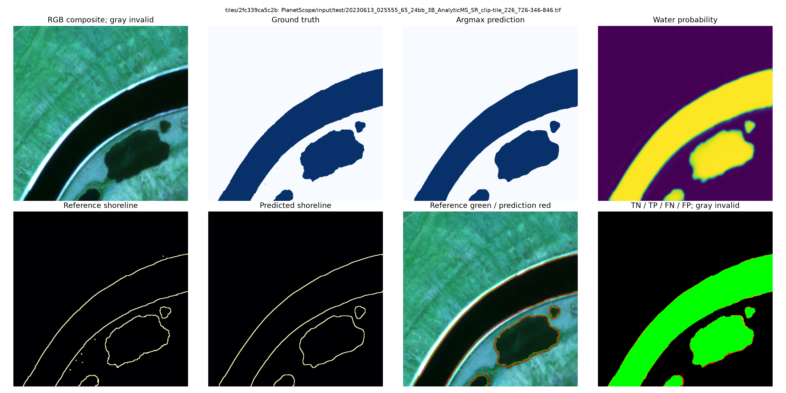

# Reservoir Shoreline Segmentation

Exploration and reproducible quality control for water segmentation and
shoreline analysis using the public RiverScope / PlanetScope dataset.

> **Work in progress.** This repository is under active development. Its
> interfaces, analyses, and documented next steps may evolve as the dataset is
> examined and the segmentation workflow is validated.

## Scope and objectives

This project develops a reproducible foundation for segmenting reservoir and
river shorelines from PlanetScope imagery. Its immediate scope is data
acquisition, inspection, and quality control; it is not yet a claim of a
validated production model or of final scientific results.

The work aims to:

- preserve the published RiverScope data and geographic split definitions;
- make image, mask, metadata, and shoreline-quality checks repeatable;
- identify label, registration, cloud, nodata, and acquisition artifacts
  before training; and
- provide reusable components for later experiments, evaluation, and
  shoreline-oriented model development.

## Current status and active development

The current implementation provides a verified acquisition path, quality
control, versioned geometry, a modular four-channel U-Net, and a reproducible
train-validation-test pipeline with resumable experiment artifacts. The
current exclusion manifest records the 98 published tiles whose image values
are entirely zero. Training and selection preserve the published geographic
partitions; test remains locked throughout those stages and is only evaluated
after a validation-selected checkpoint has been frozen.

The repository now also provides a versioned geometry-processing script that
derives binary labels, explicit validity maps, thick 8-neighbour shorelines,
and reusable squared distance maps without modifying the original data. See
[the data-processing guide](docs/data-processing.md).

## First post-selection test result

The active `training-pipeline` branch now contains its first end-to-end test
result. It evaluates the frozen weighted cross-entropy U-Net checkpoint chosen
on validation only; the 224 test tiles did not participate in configuration
selection, early stopping, or checkpoint selection. This is an initial,
reproducible result rather than a final scientific claim.

| Test measure | Result |
| --- | ---: |
| Tiles / geographic groups / valid pixels | 224 / 46 / 55,546,991 |
| Global masked water Dice | 0.9411 |
| Global masked water IoU | 0.8887 |
| Global masked accuracy | 0.9735 |
| Boundary F1 at 2 px (geographic macro) | 0.6115 |
| ASSD, defined cases only | 9.2904 px |
| HD95, defined cases only | 49.2655 px |
| Selection ASSD (geographic macro, explicit penalties) | 33.8646 px |

The reported standard ASSD and HD95 omit only their mathematically undefined
one-empty-boundary cases; they are not silently removed from the evaluation.
There were 217 tiles with both boundaries present, two with both empty, and
five prediction-only cases. The selection ASSD retains those five failures by
applying the documented tile-diagonal penalty. The full historical record
includes the frozen configuration, training curves, provenance, and metric
conventions: [first post-selection test result](docs/history/2026-10-23-first-test-results.md).

## What is included

- `notebooks/01_dataset_exploration.ipynb` loads official RiverScope split CSVs,
  materializes a reproducible sample, checks GeoTIFF metadata and alignment,
  visualizes RGB/NIR compositions and labels, inspects coast boundaries and
  distance-based weights, audits split identifiers, performs the numerical
  zero-value check, and provides an on-demand paginated gallery.
- `notebooks/02_distance_maps_qc.ipynb` checks the generated binary, valid,
  boundary, distance, and weight maps against their original multiclass label.
- `src/reservoir_segmentation/` contains reusable utilities for downloading
  and verifying the official archive, reading split CSVs, extracting samples,
  reading TIFF metadata, inspecting boundaries, and computing distance maps.
- `scripts/prepare_riverscope.py` derives geometry maps and per-split manifests
  from the RiverScope ZIP or an extracted dataset. Its output is cacheable
  across all `sigma` and `alpha` experiments.
- `src/reservoir_segmentation/models/` provides the configurable U-Net. It
  pads inputs internally and returns original-size logits for two-class CE.
- `src/reservoir_segmentation/training/` provides manifest-backed datasets,
  train-only normalization, reproducibility controls, masked losses, regional
  and shoreline metrics, training/evaluation loops, checkpointing, and
  resumable grid-search artifacts.
- `notebooks/03_grid_search.ipynb`, `04_train_model.ipynb`, and
  `05_test_visualization.ipynb` run progressive configuration search, final
  train/validation, and strictly post-selection test evaluation.
- `tests/` covers the reusable utilities with synthetic inputs.

See [the training and evaluation guide](docs/training.md) for the split lock,
validity policy, losses, metrics, checkpoint rule, reproducibility limits, and
notebook workflow.

## Data-quality decisions

The official RiverScope archive and split CSVs are never modified. Explicit
quality exclusions for derived training and evaluation workflows are recorded
in [`configs/riverscope_quality_exclusions.csv`](configs/riverscope_quality_exclusions.csv).
See [docs/data-quality.md](docs/data-quality.md) for the policy, evidence, and
reproducible filtering procedure.

The current manifest contains 98 exact tile-path exclusions for
`all_zero_imagery` (71 training, 16 validation, and 11 test tiles). Each row
records `nonzero_values = 0`; derived samples, the paginated gallery, and
future training or evaluation manifests must apply this file before selecting
tiles.

The notebook preserves the published multiclass labels: `0 = background`,
`1 = river water`, and `2 = other water`. Its binary inspection view treats
labels `1` and `2` as water, but does not overwrite the original mask.

The supplied archive also has a small number of undocumented label-`3` pixels.
Derived geometry treats them as invalid/no-data, so they are excluded from
shoreline supervision, losses, and metrics while the original labels remain
unchanged.

The notebook reports observations about data quality. It does not claim model
accuracy and does not silently repair annotations or interpret nodata as land.

## Obtain RiverScope faithfully

The authoritative download is the [RiverScope Zenodo record](https://zenodo.org/records/15376394).
The official archive is approximately 8.1 GB compressed and contains the
published CSVs and co-registered products. The official repository documents
the layout and provides the same download link at
<https://github.com/cvl-umass/riverscope>.

For the least transformed copy:

1. Download `RiverScope.zip` from Zenodo, or let the notebook call the explicit
   downloader by setting `DOWNLOAD_DATASET = True`.
2. Verify MD5 `910f3ffc046cbf60df30c27937555fa5`.
3. Keep the archive unchanged and extract it without converting, resampling,
   renaming, or recompressing the GeoTIFFs.
4. Point `RIVERSCOPE_DATA` to the extracted folder, or place the archive at
   `data/raw/RiverScope.zip`.

The downloader validates the MD5 before replacing the final file and extracts
only the selected sample when the notebook reads a ZIP. The complete archive
and generated data stay outside Git.

## Environment setup on Windows

The repository uses its existing `.venv` environment for development and the
notebook. Install one explicit PyTorch runtime profile *before* the declared
notebook and development extras; do not create a parallel environment. This
is necessary because a bare PyPI PyTorch install can resolve to a CPU-only
wheel, which is unsuitable for the full training and grid-search notebooks.

From the repository root in Git Bash:

~~~
.venv/Scripts/python.exe -m pip install --upgrade pip
.venv/Scripts/python.exe -m pip install -r requirements/torch-cu128.txt
.venv/Scripts/python.exe -m pip install -e ".[notebooks,dev]"
.venv/Scripts/python.exe -m ipykernel install --user --name reservoir-shoreline-segmentation --display-name "Python (Reservoir Shoreline Segmentation)"
~~~

`requirements/torch-cu128.txt` is the required NVIDIA CUDA 12.8 profile for
full training and grid search, including RTX 50-series hardware. Its pinned
wheel supports the RTX 5080. Ensure the NVIDIA driver is current, then verify
the selected environment before opening Jupyter:

~~~
.venv/Scripts/python.exe -c "import torch; assert torch.cuda.is_available(), 'CUDA is unavailable'; print(torch.__version__); print(torch.version.cuda); print(torch.cuda.get_device_name(0))"
~~~

For a CPU-only test or smoke-test environment, install
`requirements/torch-cpu.txt` in place of the CUDA profile. Do not run the
full grid search after installing that profile.

Open the notebook with:

~~~
.venv/Scripts/jupyter.exe notebook notebooks/01_dataset_exploration.ipynb
~~~

If activation is unavailable, use the environment directly:

~~~
.venv/Scripts/python.exe -m pip install -r requirements/torch-cu128.txt
.venv/Scripts/python.exe -m pip install -e ".[notebooks,dev]"
.venv/Scripts/jupyter.exe notebook notebooks/01_dataset_exploration.ipynb
~~~

If `.venv` is absent, create it once with `python -m venv .venv`, then run the
same installation commands. PowerShell users can activate it with
`.venv/Scripts/Activate.ps1`, but activation is optional.

## Dataset location

The notebook first checks `RIVERSCOPE_DATA`, then `data/raw/riverscope`, and
finally `data/raw/RiverScope.zip`. Keep downloaded data outside Git; the
repository ignores `data/raw/`, `data/processed/`, and archive files.

~~~
export RIVERSCOPE_DATA=./data/raw/riverscope
jupyter notebook notebooks/01_dataset_exploration.ipynb
~~~

PowerShell equivalent:

~~~powershell
$env:RIVERSCOPE_DATA = ".\data\raw\riverscope"
~~~

## Run tests and notebook

~~~
python -m pytest
python -m ruff check src tests
jupyter notebook notebooks/01_dataset_exploration.ipynb
~~~

For train/validation experiments, set `RIVERSCOPE_DATA` or update the source
path in the numbered training notebooks. Use CPU for tests and smoke tests;
run full training and grid search only on an available CUDA environment.

If no dataset is available, the notebook still opens and prints the official
download URL and expected layout.

## License

Original code in this repository is MIT-licensed; see `LICENSE`. RiverScope's
official repository is marked CC0-1.0, while the Zenodo archive and the
underlying Planet imagery must be used according to their own current terms.
See [docs/licensing.md](docs/licensing.md) before sharing data or derived
products.
