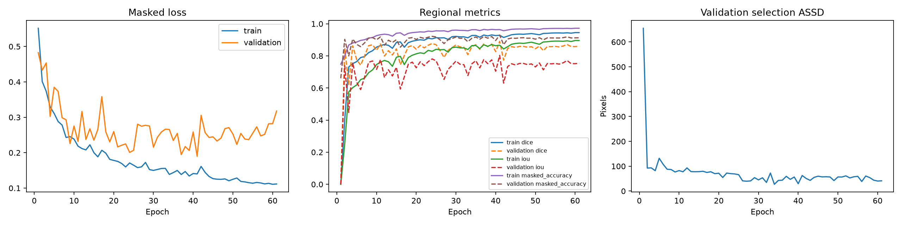

# Historical record: first post-selection test result

- **Recorded:** 2026-10-23
- **Branch:** training-pipeline
- **Status:** first reproducible end-to-end result; not a final scientific or
  production validation.

## Scope

This is the first recorded evaluation of the frozen final-training checkpoint
on the published test partition. The test partition was not used to choose the
loss, architecture, hyperparameters, checkpoint, or early-stopping point. The
grid search and final checkpoint selection used only the published train and
validation partitions.

The evaluation contains 224 test tiles in 46 geographic groups and 55,546,991
valid pixels. As elsewhere in the project, published all-zero imagery is
excluded through the versioned quality manifest and label-3 pixels are invalid,
not a class.

## Frozen training run

| Setting | Value |
| --- | --- |
| Model | Four-channel U-Net, encoder depth 4, 16 base channels |
| Loss | Weighted Cross-Entropy, alpha = 1.0, sigma = 4.0 |
| Optimizer | AdamW, learning rate 1e-4, weight decay 1e-4 |
| Batch size | 4 |
| Maximum epochs / early-stopping patience | 200 / 20 |
| Seed / device | 42 / CUDA, deterministic mode |
| Checkpoint selection | Geographic-macro selection ASSD, constrained by validation Dice |
| Best checkpoint | Epoch 41; validation Dice 0.8909; validation selection ASSD 62.5906 px |
| Training termination | Epoch 61 after early-stopping patience |

The run provenance records Git commit
55f2cf38689f55fa7c51cc0b1e545b35aa2bd39f, PyTorch 2.11.0+cu128, CUDA
12.8, NumPy 2.5.4, SciPy 1.18.1, and tifffile 2026.10.15.

## Test metrics

Regional measures are global: the valid-pixel confusion counts of every test
tile are summed before calculating Dice, IoU, and masked accuracy. Coastline
measures are first calculated per tile, then averaged within each geographic
group and macro-averaged across the 46 groups where noted.

| Measure | Result |
| --- | ---: |
| Global masked water Dice | 0.9411 |
| Global masked water IoU | 0.8887 |
| Global masked accuracy | 0.9735 |
| Boundary F1 at 2 px (geographic macro) | 0.6115 |
| ASSD, defined cases only | 9.2904 px |
| HD95, defined cases only | 49.2655 px |
| Selection ASSD (geographic macro) | 33.8646 px |

The complete regional confusion counts were 11,767,349 true positives,
723,437 false positives, 750,114 false negatives, and 42,306,091 true
negatives.

### Empty-boundary accounting

| Boundary case | Test tiles | Treatment |
| --- | ---: | --- |
| Both boundaries present | 217 | Standard Boundary F1, ASSD, and HD95 |
| Both boundaries empty | 2 | Boundary F1 = 1; ASSD = HD95 = 0 |
| Prediction only | 5 | Boundary F1 = 0; standard ASSD/HD95 undefined; tile-diagonal penalty in selection ASSD |
| Reference only | 0 | Would receive the same undefined-distance and penalty treatment |

Standard ASSD and HD95 are reported as means over defined cases only. The five
prediction-only failures therefore remain visible in the table and are
included in the selection ASSD via the explicit tile-diagonal penalty; no
failed detection is silently discarded.

## Training curves

The figure shows all 61 completed epochs, not only the selected epoch. It
contains masked train/validation loss, regional Dice/IoU/masked accuracy, and
the validation selection ASSD used for scheduling and checkpoint selection.

## Representative test reconstruction

The test tile below is the versioned copy of final-test visualization
2fc339ca5c2b. It is a qualitative example, not a cherry-picked summary
metric: the numerical result above is calculated over all 224 test tiles. The
eight panels show the RGB composite, reference mask, argmax prediction, water
probability, reference and predicted shorelines, their overlay, and the
masked error map. Invalid pixels appear gray where applicable.

## Artifact lineage

The run-generated source artifacts remain outside version control in the
ignored artifacts/ directory:

- artifacts/experiments/final_train_validation/summary.json
- artifacts/experiments/final_train_validation/run_config.json
- artifacts/experiments/final_train_validation/provenance.json
- artifacts/experiments/final_train_validation/metrics.jsonl
- artifacts/evaluations/final_test/test_tile_metrics.csv

The two images embedded above are stable copies stored under
docs/assets/first-test-results/ so this historical record remains visible in
Git independently of local ignored artifacts. The full method, split lock,
loss definition, and metric conventions are specified in
[the training and evaluation guide](../training.md).
